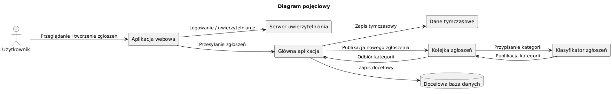
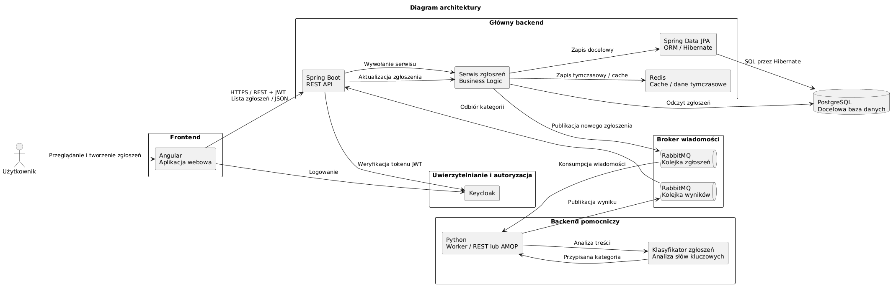

# System obsługi zgłoszeń (ticketów)

## Opis projektu

System umożliwia użytkownikowi tworzenie i przeglądanie zgłoszeń. Użytkownik loguje się do systemu przy użyciu Keycloak. Zgłoszenie trafia poprzez serwer kolejek do backendu pomocniczego, gdzie na podstawie słów kluczowych jest mu przydzielana kategoria. Nadana kategoria jest przesłana z serwera pomocniczego do serwer głównego. Sewer główny zapisuje zgłoszenie w docelowym repozytorium (PostgreSQL).

## Skład zespołu
* Mikołaj Bucki
* Kamil Dąbrowski
* Maria Dziok
* Piotr Górecki
* Maciej Grzędowicz

## Planowany zakres
* logowanie użytkownika przy użyciu Keycloak
* interfejs użytkownika (Angular)
* zapisywanie zgłoszeń w systemie kolejkowym
* przydzielanie kategorii przez backend pomocniczy
* zapisywanie w docelowym repozytorium


## Diagram
### Diagram pojęciowy

### Diagram architektury


## Docker
Struktura projektu:
```text
project/
├── pd-tickets (główny backend)
    ├── (tu uruchamiamy dockera)
├── pd-tickets-ui (frontend, można uruchomić niezależnie -> README projektu)
├── pd-tickets-worker (drugi backend w Python, można uruchomić niezależnie -> README projektu)
```

W katalogu głównego backendu:
```bash
docker compose up --build -d
```
Polecenie uruchamia frontend i oba backendy, bazę PostgreSQL oraz RabbitMQ.

Frontend: http://localhost:8081 

```json
{
  "message": "Przykładowa treść wiadomości",
  "user": "user",
  "send_time": "2026-10-20T07:00:00+00:00"
}
```


RabbitMQ: http://localhost:15672 (dane logowania w przykładowym środowisku: user / user)

*(Więcej o korzystaniu z RabbitMQ w README workera)*

PostgreSQL: przeglądanie zapisanych zgłoszeń w terminalu 
```bash
docker compose exec postgres psql -U user -d mydatabase -c "SELECT * from tickets;"
```

```bash
INSERT INTO tickets
    (category, message, processed_at, send_time, username)
VALUES (?, ?, ?, ?, ?);
```

Przy zamknięciu kontenera usuwany jest schemat bazy danych: `spring.jpa.hibernate.ddl-auto=create-drop` 


TODO: dodać integrację z Keycloak i Redis.

Usunięcie kontenerów:
```bash
docker compose down
```

Usunięcie kontenerów z danymi kolejek:
```bash
docker compose down -v
```
