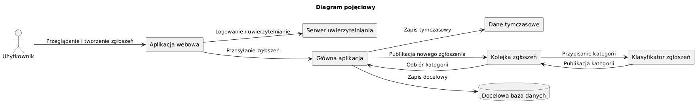
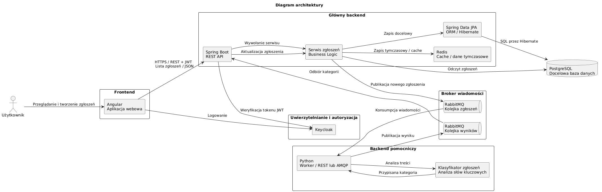

# System obsługi zgłoszeń (ticketów)

## Opis projektu

System umożliwia użytkownikowi tworzenie i przeglądanie zgłoszeń. Użytkownik loguje się do systemu przy użyciu Keycloak. Zgłoszenie trafia poprzez serwer kolejek do backendu pomocniczego, gdzie na podstawie słów kluczowych jest mu przydzielana kategoria. Nadana kategoria jest przesłana z serwera pomocniczego do serwer głównego. Sewer główny zapisuje zgłoszenie w docelowym repozytorium (PostgreSQL).

## Skład zespołu
* Mikołaj Bucki
* Kamil Dąbrowski
* Maria Dziok
* Piotr Górecki
* Maciej Grzędowicz

## Planowany zakres
* logowanie użytkownika przy użyciu Keycloak
* interfejs użytkownika (Angular)
* zapisywanie zgłoszeń w systemie kolejkowym
* przydzielanie kategorii przez backend pomocniczy
* zapisywanie w docelowym repozytorium


## Diagram
### Diagram pojęciowy

### Diagram architektury


## Docker
Struktura projektu:
```text
project/
├── pd-tickets (główny backend)
    ├── (tu uruchamiamy dockera)
├── pd-tickets-ui (frontend, można uruchomić niezależnie -> README projektu)
├── pd-tickets-worker (drugi backend w Python, można uruchomić niezależnie -> README projektu)
```

W katalogu głównego backendu:
```bash
docker compose up --build -d
```
Polecenie uruchamia frontend i oba backendy, bazę PostgreSQL oraz RabbitMQ.

Frontend: http://localhost:8081 

```json
{
  "message": "Przykładowa treść wiadomości",
}
```


RabbitMQ: http://localhost:15672 (dane logowania w przykładowym środowisku: user / user)

*(Więcej o korzystaniu z RabbitMQ w README workera)*

PostgreSQL: przeglądanie zapisanych zgłoszeń w terminalu 
```bash
docker compose exec postgres psql -U user -d mydatabase -c "SELECT * from tickets;"
```

```bash
INSERT INTO tickets
    (category, message, processed_at, send_time, username)
VALUES (?, ?, ?, ?, ?);
```

W środowisku lokalnym ustaiono `spring.jpa.hibernate.ddl-auto=update`, aby tabele bazy danych nie były automatycznie usuwane podczas zamyykania aplikacji. 


TODO: dodać integrację z Redis.

Usunięcie kontenerów:
```bash
docker compose down
```

Usunięcie kontenerów z danymi kolejek:
```bash
docker compose down -v
```

## Keycloak

Keycloak odpowiada za logowanie użytkowników do aplikacji.

1. Uruchom projekt poleceniem `docker compose up -d --build`.
2. Otwórz panel administracyjny: http://localhost:8082 (lokalnie: `admin / admin`).
3. Utwórz **realm** o nazwie `pd-tickets`.
4. Konfiguracja klienta frontendu:
    W **Clients → Create client** skonfiguruj klienta:
    - **Client type:** OpenID Connect
    - **Client ID:** `pd-tickets-ui`
    - **Client authentication:** Off
    - **Standard flow:** On
    - **Valid redirect URIs:** `http://localhost:8081/*`
    - **Web origins:** `http://localhost:8081`
    - **PKCE:** S256
    
    Konfiguracja klienta backendu:
    W **Clients → Create client** skonfiguruj klienta:
    - **Client type:** OpenID Connect
    - **Client ID:** `pd-tickets-api`
    - **Client authentication:** Off
    - **Standard flow:** On
    - **Standard flow:** Off

    Konfiguracja Audience Mapper:
    1. Przejdź do **Clients → pd-tickets-ui → Client scopes → pd-tickets-ui-dedicated → Mappers**.
    2. Wybierz **Configure a new mapper → Audience**.
    3. Ustaw:
    - **Name:** `pd-tickets-api-audience`
    - **Included Client Audience:** `pd-tickets-api`
    - **Add to access token:** On
    - **Add to ID token:** Off
    4. Zapisz zmiany.
    
5. W **Users → Add user** utwórz użytkownika i ustaw hasło w **Credentials**.
6. Otwórz http://localhost:8081 i zaloguj się.

Konfiguracja Keycloak jest przechowywana w wolumenie Dockera. Usunięcie wolumenów może wymagać ponownej konfiguracji.